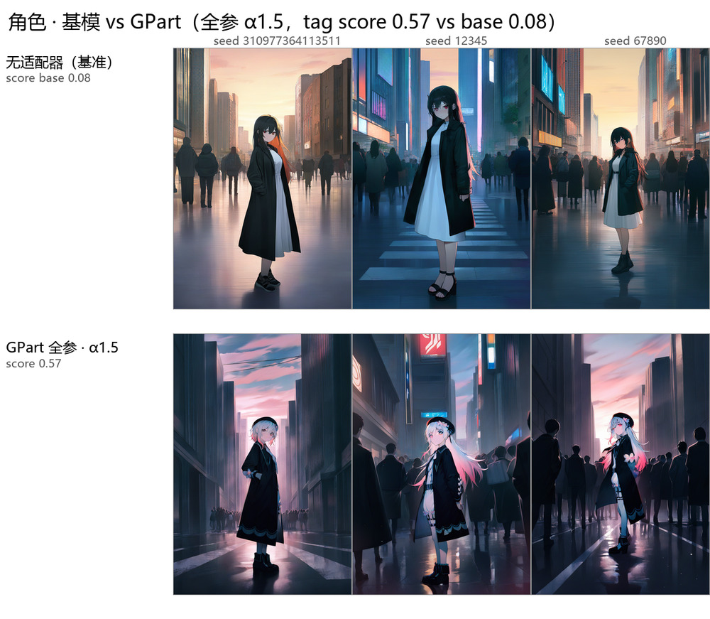
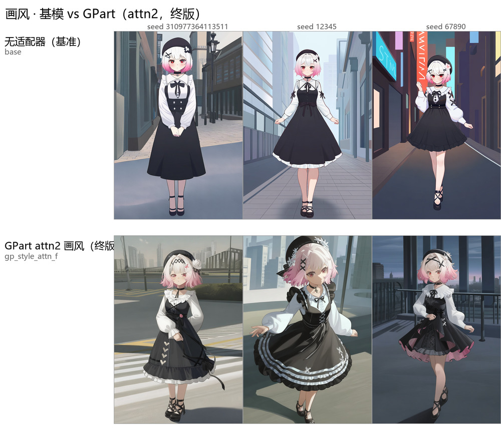
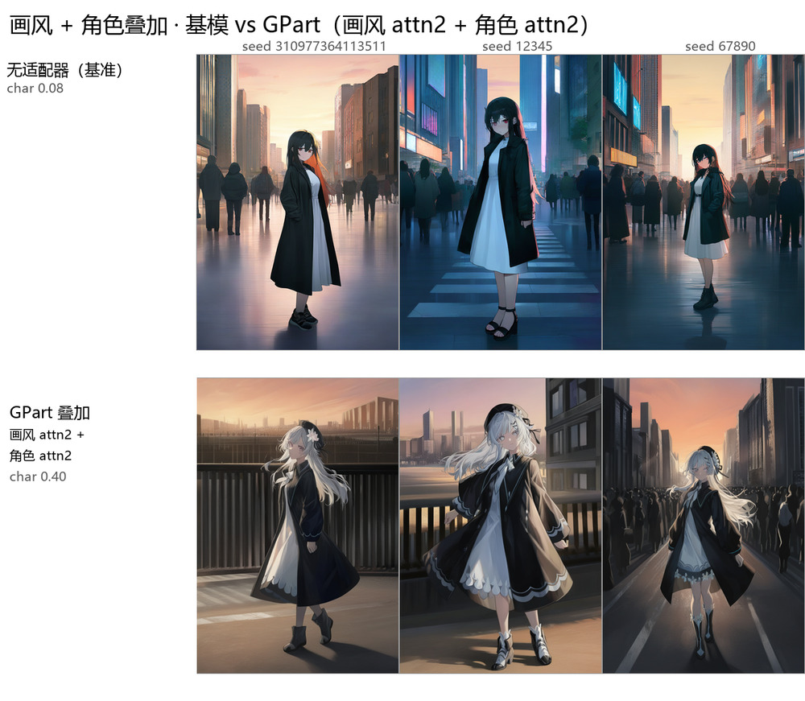

# GPart vs LoRA on SDXL — a matched-recipe comparison

**English** · [中文](README.zh-CN.md)

A small, reproducible harness for comparing **parameterization strategies for
parameter-efficient fine-tuning** on Stable Diffusion XL, plus the results of one
controlled comparison between:

- **GPart** — global full-rank parameter partition (Samsung Labs), reparameterized
  as `ΔW = P·diag(s)·θ`, `P` is a random partition with `PᵀP = I`.
- **LoRA** — low-rank `ΔW = BA`, same target modules, same rank budget.

The point of the repo is **not** "which one wins". It is:

> When two PEFT methods are trained with the *same* recipe, the *same* layer
> coverage, and each at its own *swept* strength, what difference remains —
> and where does the perceived difference come from when you don't do that?

That question has a reusable answer even if you disagree with our conclusion.

---

## What this repo contains

| | |
|---|---|
| `src/train.py` | minimal SDXL training loop for both adapters, on kohya-style latent caches |
| `src/sample.py` | deterministic sampler with adapter loading, α scaling, merging |
| `src/eval/tag_eval.py` | booru-tagger scoring of character identity tags |
| `src/eval/style_stats.py` | colour / texture statistics (dRGB, saturation, edge energy) |
| `src/eval/boot_identity.py` | paired bootstrap on the identity score, so a two-arm gap comes with an interval |
| `src/bench/` | per-step timing, parameter budget, cost-model calibration |
| `src/figures/` | contact-sheet builders used for every figure in `results/` |
| `docs/` | protocol, results, cost model, limitations, release checklist |
| `results/` | the tables (csv + md) and figures |

## Headline result

| comparison | identity | what it means |
|---|---|---|
| Open box, each method's shipped recipe | GPart 0.43 vs LoRA 0.05 | the shipped LoRA ran at lr 1e-4 and reached 1/33 of GPart's displacement — a recipe artifact |
| Matched recipe, matched coverage, each at its own best strength, prompt `p0` | GPart 0.57 vs LoRA 0.70 | LoRA wins on the most structurally demanding prompt |
| Same, on a four-framing holdout set, nominal α 1.0 | GPart 0.50 vs LoRA 0.55, 95% CI [−0.06, +0.18] | **a tie** |
| Same, at exactly **equal displacement** (GPart α 0.88) | GPart 0.42 vs LoRA 0.50, 95% CI [−0.23, +0.06] | **a tie** |
| Same, each at its own best strength on that set | GPart 0.63 vs LoRA 0.50, 95% CI [+0.03, +0.23] | GPart wins by using 1.8× the displacement |

The open-box gap was a **learning-rate artifact**; the second row is a
**prompt-set artifact** — see `docs/00-claims.md`, which splits every claim into
"robust" and "conditional" for exactly this reason. `docs/01-protocol.md` has the
exact controls and `docs/02-results-character.md` the numbers.

What does **not** move under re-testing is the style side, and the reason is not
the one the parameterization predicts:

| | best alone | stacked with a character adapter |
|---|---|---|
| kohya style LoRA (rank 32, community-trained) | SWD **3.336** | 4.67 → 5.01 → 5.56 as α rises |
| GPart style adapter | — | 3.59 – 3.71, flat |

The style adapter that transfers best is the one that falls apart when composed.
`docs/03-results-style-stacking.md` §5.

## Results at a glance

GPart at its best setting, against the base model. Prompt `p0` (clean scene,
trigger token only — the discriminating prompt), 3 of the 6 scored seeds: so all
the adapter gets to go on is the trigger. WD14 tag score is in each row label.

**Character.** Base 0.08 → GPart all-linear at α 1.5: 0.57. Hair colour, eye
colour and the accessories all come back from the trigger alone.



**Style.** The same matched recipe pointed at a style target instead of a
character.



**Stacking.** A style adapter and a character adapter loaded together — base
0.08 → 0.40, so the character survives the style adapter rather than being
averaged away.



α 1.5 is GPart's peak, and it is paid for in image quality — see
`docs/02-results-character.md` §3. These two sheets show the GPart arm only; the
LoRA runs this comparison is measured against, and full-resolution versions of
all five sheets, are in [`results/figures/`](results/figures/).

---

## Quick start

**New here?** [`quickstart/`](quickstart/README.md) walks the whole path —
install, base model, dataset, train, run — with a symptom-to-cause table at the
end. Or open `gui/app.py`: two tabs, one to train, one to sample.

Nothing trains out of the box — you need an SDXL-family UNet converted to
diffusers format, plus a latent cache. See `data/README.md`.

```bash
python -m pip install -r requirements.txt
```

### One command

```bash
python scripts/train_gpart.py \
    --data data/10_my_character --name mychar --trigger mychar \
    --identity "white hair,red eyes,beret" --preset attn2 --steps 1200
```

Audits the cache, builds the three caption variants, trains with the matched
recipe, writes `run_manifest.json`, and prints the sampling command.
`--dry-run` shows the commands without running them; see `scripts/README.md`.

### Step by step

```bash
# 1. caption variants (needs kohya's cached *_sdxl.npz / *_te_outputs.npz already present;
#    see data/README.md for the cache layout and how to make it)
python -m src.prep.caption_variants \
    --src data/10_my_character --dst data/10_my_character_var \
    --trigger mychar --identity "white hair,red eyes,beret"

# 2. train one adapter. The config carries the full matched recipe
#    (docs/01-protocol.md); CLI flags override it.
python -m src.train --config configs/gpart_char_attn2.yaml \
    --data data/10_my_character_var --output runs/gpart_char_attn2

# equivalently, all flags spelled out:
#   --adapter gpart --d 23224320 \
#   --targets attn2.to_q attn2.to_k attn2.to_v attn2.to_out.0 \
#   --scope transformer_block --layers-pattern transformer_blocks \
#   --steps 1200 --lr 5e-4 --lr-schedule constant --warmup 50 --grad-accum 2 \
#   --max-res 1536 --noise-offset 0.05 --min-snr-gamma 5 --seed 42

# 3. sample and score
python -m src.sample --adapter-dir runs/gpart_char_attn2/adapter --alpha 1.0 \
    --prompts-file configs/prompts/p0_p1.jsonl --seeds 1 2 3 \
    --steps 30 --cfg 5 --size 832 1216 \
    --sched euler_a --spacing trailing --output runs/samples
python -m src.eval.tag_eval --model /path/to/wd14/model.onnx \
    --dirs base=runs/samples_base gp=runs/samples --md
```

**`--sched euler_a --spacing trailing` is not optional.** `src/sample.py` defaults
to `euler` + `leading`, which is not the sampler that produced `results/` —
`leading` shifts every image, so a "failed reproduction" here is usually just the
spacing flag. Every config pins both values explicitly.

`configs/*.yaml` holds the exact settings for every row in `results/`; the `train:`
block plus the top-level keys are what `--config` reads. The `sample:` block is a
record for `src/sample.py` and is not read by the trainer — see `configs/README.md`.

## Repository layout

```
.
├── quickstart/         install → models → dataset → train → run, step by step
├── gui/                GPart Studio: a two-tab tkinter app (train | sample)
├── configs/            one YAML per row of results/tables, + prompts/
│   └── prompts/        p0_p1.jsonl (p0 clean, p1 full), p2_heldout.jsonl, style.jsonl
├── src/
│   ├── train.py        training loop (GPart | LoRA), --config aware
│   ├── sample.py       sampling: adapter loading, α, merging, multi-prompt
│   ├── data.py         kohya SDXL latent cache reader
│   ├── prep/           caption_variants.py, convert_unet.py
│   ├── eval/           tag_eval.py, style_stats.py, boot_identity.py, check_adapter.py
│   ├── bench/          bench_d.py, param_budget.py, profile_train_step.py
│   └── figures/        contact-sheet builders for every figure
├── third_party/GPart/  vendored GPart/PEFT (Apache-2.0), patched — see THIRD_PARTY.md
├── results/
│   ├── tables/         character / style / stacking / step_curve / cost, csv + md
│   └── figures/        the five contact sheets (ASCII names), + readme/ JPEGs
├── docs/               00 claims → 01 protocol → 02–03 results → 04 cost
│                       → 05 limitations → 06 release checklist
└── scripts/
    ├── train_gpart.py  one-click training: dataset dir in, adapter out
    ├── history/        the as-run log, dated, not maintained
    └── README.md       which script produced which row
```

## Scope

Read `docs/00-claims.md` before citing anything. In short:

- **One character, one style, one base model.** Not a general claim about
  low-rank vs full-rank PEFT.
- **Not every knob was swept.** We swept strength (α / LoRA scale), layer
  coverage, prompt set, and training recipe. We did **not** sweep GPart's `d`,
  nor its learning rate. LoRA rank was tested at r8 and r32 (the community
  adapter), not in between. The lr gap matters: we showed the open-box result
  was an lr artifact by moving *LoRA* to GPart's lr, never by moving *GPart* to
  another one.
- **A 0.13 difference in either direction is what changing the test set buys.**
  The prompt set moved the identity gap 0.22 and stacking a style adapter moved
  it 0.09. Quote an identity number together with its configuration.
- **No text-encoder training.** The vendored GPart path only trains the UNet;
  LoRA could train the TE but did not in these runs.

## What this repo does not claim

Do not extend the results with any of these:

- **"Low-rank beats full-rank partition."** One character, one style, one base
  model.
- **"GPart cannot do X."** One configuration family; `d`, lr and target modules
  were not swept out.
- **"GPart is slow."** The 4.2× is our implicit-partition backend in 8 GB of
  VRAM, not a property of the method. Upstream materializes the assignment table;
  we could not run it, so we have no benchmark for it.
- **"LoRA is the better base for adapter composition."** We tested the plainest
  additive merge (`ΔW₁ + ΔW₂`) — the one operation where LoRA's cross terms
  happen not to matter. GPart's actual claim is *exact linear composition in
  shared coordinates* under TIES, orthogonalization, sign conflicts. That was
  never implemented here; it is the largest untested gap.
- **"Tag score = image quality."** It measures booru-tagger agreement with the
  character's canonical tags. A higher score can come with worse images — the α
  sweep is exactly that: 0.57 is bought with a global colour cast and lost detail.

## Reading order

| | |
|---|---|
| `docs/00-claims.md` | what the repo claims and — longer — what it does not |
| `docs/01-protocol.md` | the controls, and the failure mode they are designed against |
| `docs/02-results-character.md` | character identity: the headline, the coverage test, the α sweep |
| `docs/03-results-style-stacking.md` | style transfer and additive stacking |
| `docs/04-cost-model.md` | seconds/step, and why the hash is not the bottleneck |
| `docs/05-limitations.md` | every untested knob, listed |
| `docs/06-release-checklist.md` | IP, licenses, path cleanup — before this goes public |
| `MIGRATION.md` | working tree → this repo, file by file |

Simplified Chinese translations of `docs/00`–`06` sit next to the originals as
`docs/*.zh-CN.md`. Section numbers, tables and numbers mirror the English, and
ambiguous terms (partition, adapter, checkpoint, α/strength, target module) are
left untranslated. **Where the two disagree, the English is authoritative.**

## License and content

Code: Apache-2.0 (see `LICENSE`). The vendored GPart/PEFT code keeps its original
license — see `THIRD_PARTY.md`. No model weights, latent caches or source images
are included.

`results/figures/` contains generated contact sheets showing characters derived
from third-party artwork. `docs/06-release-checklist.md` §1 records the
considerations; the maintainer's decision is to ship them, and a reuser who needs
a different call can drop `results/figures/` — the comparison does not depend on
a reader seeing the images, though its persuasiveness does.
