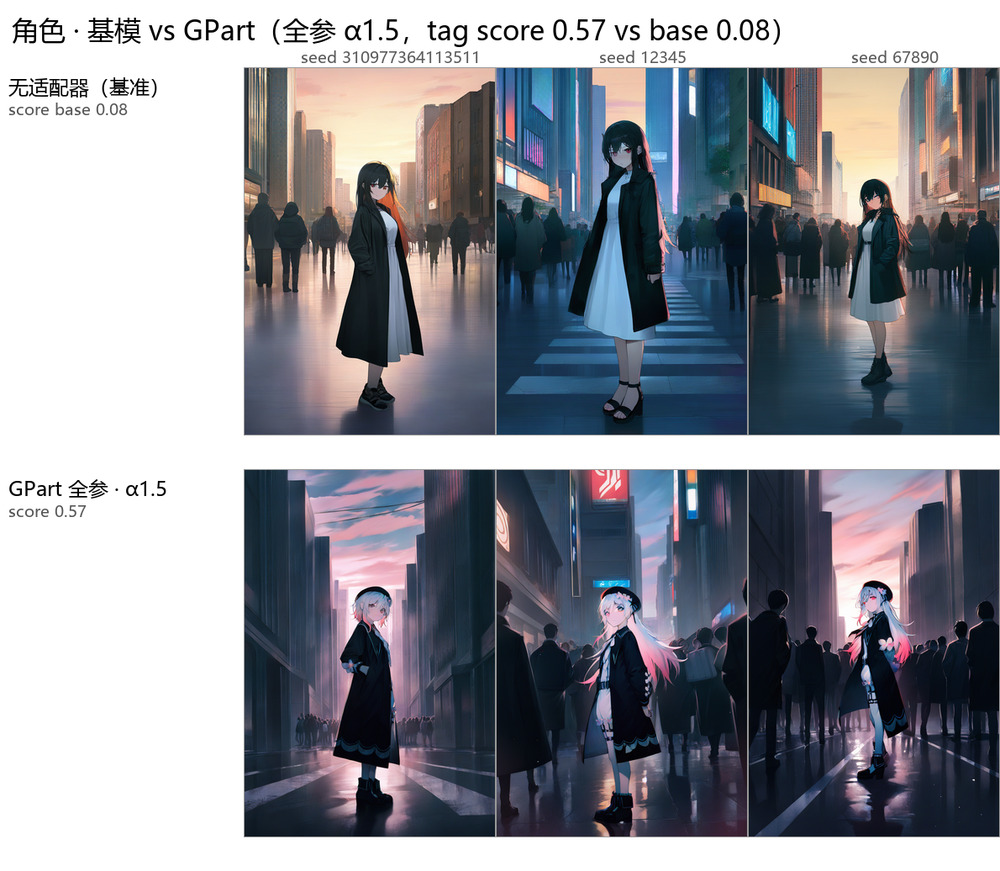
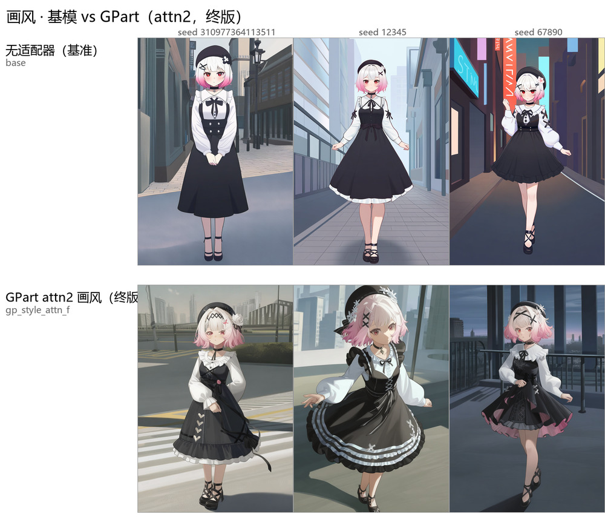
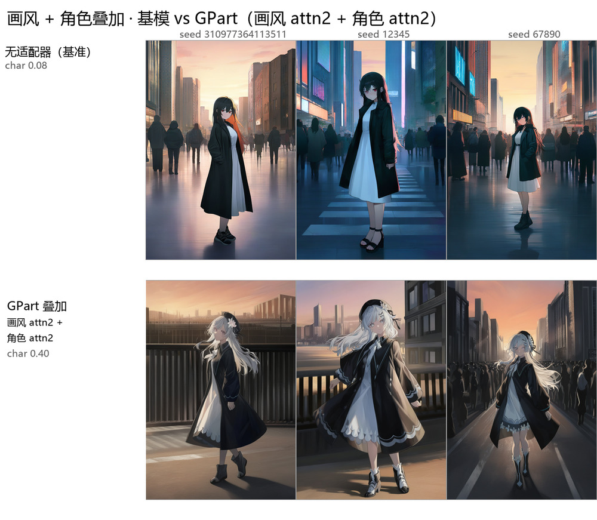

# GPart vs LoRA on SDXL：同一套训练配方下还剩多少差距

[English](README.md) · **中文**

一个用来横向对比 **参数高效微调（PEFT）的参数化方式** 的小型可复现工具链，
外加一次受控实验的结果。对比的两种方法是：

- **GPart** —— 全局满秩参数划分（Samsung Labs），重参数化为 `ΔW = P·diag(s)·θ`，
  `P` 是满足 `PᵀP = I` 的随机划分矩阵。
- **LoRA** —— 低秩 `ΔW = BA`，目标模块相同，参数量同量级。

这个仓库真正要回答的不是「谁赢」，而是：

> 当两种 PEFT 用**同一套训练配方**、**同一个层覆盖范围**、并且各自都在**自己扫出来的
> 最优强度**上训练时，差距还剩多少？而当你没有对齐这些条件时，你看到的那个差距，
> 究竟是从哪来的？

即使你不同意我们的结论，这个问题本身的答案是可以复用的。

---

## 仓库里有什么

| | |
|---|---|
| `src/train.py` | 两种适配器的最小 SDXL 训练循环，读 kohya 格式的 latent 缓存 |
| `src/sample.py` | 确定性采样：加载适配器、α 缩放、合并、多提示词 |
| `src/eval/tag_eval.py` | 用 booru tagger 给角色特征标签打分 |
| `src/eval/style_stats.py` | 色彩 / 纹理统计（dRGB、饱和度、边缘能量） |
| `src/eval/boot_identity.py` | 身份分数的配对 bootstrap，给两臂差距一个置信区间 |
| `src/bench/` | 步时测量、参数预算、成本模型标定 |
| `src/figures/` | `results/` 里每一张对比图的拼图脚本 |
| `docs/` | 协议 → 结果 → 成本 → 局限 → 发布前核查 |
| `results/` | 数据表（csv + md）和对比图 |

## 一句话结果

| 对比 | 身份 | 说明 |
|---|---|---|
| 开箱，各自官方配方 | GPart 0.43 vs LoRA 0.05 | 官方 LoRA 配 lr 1e-4，位移只有 GPart 的 1/33 —— 配方产物 |
| 配方对齐、覆盖对齐、各自取最优强度，prompt `p0` | GPart 0.57 vs LoRA 0.70 | LoRA 在结构性要求最高的那个 prompt 上赢 |
| 同上，四景别留出集，名义 α 1.0 | GPart 0.50 vs LoRA 0.55，95% CI [−0.06, +0.18] | **打平** |
| 同上，**严格等位移量**（GPart α 0.88） | GPart 0.42 vs LoRA 0.50，95% CI [−0.23, +0.06] | **打平** |
| 同上，各自取最优强度 | GPart 0.63 vs LoRA 0.50，95% CI [+0.03, +0.23] | GPart 靠 1.8 倍位移赢 |

开箱那个差距是**学习率造成的**；第二行那个是 **prompt 集造成的**。这正是
`docs/00-claims.md` 把主张拆成「稳」和「有条件」两栏的原因。
对齐了哪些变量见 `docs/01-protocol.md`，数字见 `docs/02-results-character.md`。

重新测也不动的是画风那一侧，而且原因不是参数化理论预料的那个：

| | 单挂最好 | 叠角色 adapter |
|---|---|---|
| kohya 画风 LoRA（rank 32，社区训） | SWD **3.336** | α 越大越差：4.67 → 5.01 → 5.56 |
| GPart 画风 adapter | — | 3.59 – 3.71，基本不动 |

**画风学得最好的那个，叠起来最差。** 见 `docs/03-results-style-stacking.zh-CN.md` §5。

## 结果一览

GPart 取最优强度，和基模对比。prompt 用 `p0`（干净场景，只有 trigger token ——
有区分度的那个 prompt），从 6 个打分的 seed 里取 3 个：也就是说 adapter 能依靠的
只有那个 trigger。WD14 tag score 标在每行开头。

**角色。** 基模 0.08 → GPart 全参 α1.5：0.57。发色、瞳色、配饰，全都只靠 trigger
就还原出来了。



**画风。** 同一套对齐配方，目标从角色换成画风。



**叠加。** 画风 adapter 和角色 adapter 同时加载 —— 基模 0.08 → 0.40，角色没有被
画风平均掉，而是留下了。



α1.5 是 GPart 的峰值，这个峰值是用图像质量换来的 —— 见
`02-results-character.zh-CN.md` §3。这两张只展示 GPart 这一条臂；作为对照的 LoRA
结果，以及五张对比图的全尺寸版本，都在 [`results/figures/`](results/figures/)。

---

## 快速开始

**第一次用？** [`quickstart/`](quickstart/README.md) 从装依赖、放底模、备数据一路
写到训练、出图、报错对照。或者直接开 `gui/app.py`：两个页签，一个训练一个出图。

开箱即训是不存在的 —— 你需要先把一个 SDXL 系 UNet 转成 diffusers 格式，并准备好
latent 缓存。见 `data/README.md`。

```bash
python -m pip install -r requirements.txt
```

### 一条命令

```bash
python scripts/train_gpart.py \
    --data data/10_my_character --name mychar --trigger mychar \
    --identity "white hair,red eyes,beret" --preset attn2 --steps 1200
```

它会检查缓存、生成三种 caption 变体、用对齐配方训练、写 `run_manifest.json`，
最后打印采样命令。加 `--dry-run` 只打印不执行；细节见 `scripts/README.md`。

`--identity` 是必填的、没有默认值 —— `src/prep/caption_variants.py` 在省略时会
回退到 **aima** 的标签集，复现我们的 run 没问题，换角色就是静默错误，所以包装脚本
直接拒绝继承这个默认。

### 分步执行

```bash
# 1. 生成三种 caption 变体（前提：kohya 的 *_sdxl.npz / *_te_outputs.npz 已就位，
#    缓存格式和生成方法见 data/README.md）
python -m src.prep.caption_variants \
    --src data/10_my_character --dst data/10_my_character_var \
    --trigger mychar --identity "white hair,red eyes,beret"

# 2. 训练一个适配器。config 里带着全套对齐配方（docs/01-protocol.md），
#    命令行参数优先级更高。
python -m src.train --config configs/gpart_char_attn2.yaml \
    --data data/10_my_character_var --output runs/gpart_char_attn2

# 等价于把参数全部写出来：
#   --adapter gpart --d 23224320 \
#   --targets attn2.to_q attn2.to_k attn2.to_v attn2.to_out.0 \
#   --scope transformer_block --layers-pattern transformer_blocks \
#   --steps 1200 --lr 5e-4 --lr-schedule constant --warmup 50 --grad-accum 2 \
#   --max-res 1536 --noise-offset 0.05 --min-snr-gamma 5 --seed 42

# 3. 采样并打分
python -m src.sample --adapter-dir runs/gpart_char_attn2/adapter --alpha 1.0 \
    --prompts-file configs/prompts/p0_p1.jsonl --seeds 1 2 3 \
    --steps 30 --cfg 5 --size 832 1216 \
    --sched euler_a --spacing trailing --output runs/samples
python -m src.eval.tag_eval --model /path/to/wd14/model.onnx \
    --dirs base=runs/samples_base gp=runs/samples --md
```

**`--sched euler_a --spacing trailing` 不能省。** `src/sample.py` 的默认值是
`euler` + `leading`，跟产出 `results/` 的采样器不一致 —— 尤其 `leading` 会让每张图
整体偏移，看起来「复现失败」其实只是调度器 spacing 选错。`configs/*.yaml` 里每一行
都固定写了这两个值。

`configs/*.yaml` 记录的是 `results/` 里每一行的精确设置。`--config` 读取顶层的键和
`train:` 块；`sample:` 块是给 `src/sample.py` 的记录，训练器不读 —— 详见 `configs/README.md`。

## 目录结构

```
.
├── quickstart/         装环境 → 底模 → 数据 → 训练 → 出图，一步步来
├── gui/                GPart Studio：tkinter 两页签界面（训练 | 出图）
├── configs/            每个结果行一个 YAML，另有 prompts/
│   └── prompts/        p0_p1.jsonl（p0 干净场景、p1 完整描述）、p2_heldout.jsonl、style.jsonl
├── src/
│   ├── train.py        训练循环（GPart | LoRA），支持 --config
│   ├── sample.py       采样：加载适配器、α、合并、多提示词
│   ├── data.py         kohya SDXL latent 缓存读取
│   ├── prep/           caption_variants.py、convert_unet.py
│   ├── eval/           tag_eval.py、style_stats.py、boot_identity.py、check_adapter.py
│   ├── bench/          bench_d.py、param_budget.py、profile_train_step.py
│   └── figures/        所有对比图的拼图脚本
├── third_party/GPart/  内置的 GPart/PEFT（Apache-2.0），有改动 —— 见 THIRD_PARTY.md
├── results/
│   ├── tables/         character / style / stacking / step_curve / cost，csv + md
│   └── figures/        五张横向对比图（ASCII 文件名），+ readme/ 里的缩略 JPEG
├── docs/               00 主张 → 01 协议 → 02–03 结果 → 04 成本
│                       → 05 局限 → 06 发布核查
└── scripts/
    ├── train_gpart.py  一键训练：数据集目录进，适配器出
    ├── history/        当初实际执行的脚本，按日期，不再维护
    └── README.md       哪个脚本产出了哪一行
```

## 适用范围（引用前必读）

完整清单在 `docs/00-claims.md`。简版：

- **一个角色、一种画风、一个底模。** 这不是关于「低秩 vs 满秩 PEFT」的一般性结论。
- **不是所有旋钮都扫过。** 扫了强度（α / LoRA scale）、层覆盖、prompt 集、训练配方；
  **没扫** GPart 的 `d`、**没扫** GPart 的学习率；LoRA rank 测了 r8 和 r32（社区那个），
  中间没测。lr 那条最要紧：我们证明了「开箱差距来自 lr」，靠的是把 *LoRA* 挪到
  GPart 的 lr，从没把 *GPart* 挪到别的 lr。
- **0.13 的差距，无论朝哪边，都只是换测试集能换出来的量。** 换 prompt 集让身份差距
  摆了 0.22，叠一个画风 adapter 再摆 0.09。引用身份数字时请连配置一起引。
- **没训 text encoder。** 内置的 GPart 路径只能训 UNet；LoRA 能训 TE，但这批实验里也没训。
- **「训练慢 4 倍」说的是本仓库的 `stateless` 后端**，不是 GPart 这个方法。
  详见 `docs/04-cost-model.md`。

## 以下结论本仓库不支持

引用时请不要往上面加：

- 「低秩分解比满秩划分更好」—— 单角色单画风单底模，撑不起这句话。
- 「GPart 做不到 X」—— 我们只测了一个配置族，`d`、lr、目标模块都没扫开。
- 「GPart 训练慢」—— 4.2× 是我们 8 GB 显存下隐式划分实现的代价，
  不是方法属性。上游实现物化分配表，我们跑不动，也就没基准。
- 「LoRA 更适合做适配器组合」—— 只测了最朴素的加法合并（`ΔW₁ + ΔW₂`），
  而这恰恰是 LoRA 交叉项不起作用的那个操作。GPart 真正的卖点是
  **在共享坐标系下的精确线性组合**，在 TIES、正交化这类非线性合并下才成立 ——
  那部分我们没实现，是最大的未测缺口。
- 「tag 分数 = 图像质量」—— 它衡量的是 booru tagger 对这个角色标准标签的认同度。
  分数更高的图完全可以更差，α 扫描就是这个现象：0.57 是用整幅偏色和细节糊掉换的。

## 阅读顺序

| | | |
|---|---|---|
| `docs/00-claims.md` | `00-claims.zh-CN.md` | 有据可查的主张，以及更长的那份「不主张」清单 |
| `docs/01-protocol.md` | `01-protocol.zh-CN.md` | 对齐了哪些变量，以及这套协议是防哪种混乱的 |
| `docs/02-results-character.md` | `02-results-character.zh-CN.md` | 角色还原：开箱结论、覆盖排除、α 扫描 |
| `docs/03-results-style-stacking.md` | `03-results-style-stacking.zh-CN.md` | 画风迁移与加法叠加 |
| `docs/04-cost-model.md` | `04-cost-model.zh-CN.md` | 每步耗时，以及为什么瓶颈不是哈希 |
| `docs/05-limitations.md` | `05-limitations.zh-CN.md` | 每一个没测的旋钮，逐条列 |
| `docs/06-release-checklist.md` | `06-release-checklist.zh-CN.md` | IP、许可证、路径清理 —— 公开之前 |
| `MIGRATION.md` | — | 工作树 → 本仓库，逐文件 |

中文版是英文版的镜像，章节编号、表格、数字一一对应。有歧义的术语（partition、
adapter、checkpoint、强度/α、target module 等）保留英文原词，不翻译 —— 这些词在
中文里的对应译法不止一种，翻成中文反而更容易读歪。**两份内容不一致时，以英文版
为准。**

## 许可与内容

代码 Apache-2.0（见 `LICENSE`）。内置的 GPart/PEFT 保留原许可证 —— 见 `THIRD_PARTY.md`。
不含任何模型权重、latent 缓存或原始训练图片。

`results/figures/` 里是生成的对比图，图中角色衍生自第三方作品。
`docs/06-release-checklist.md` §1 记录了相关的考量；维护者决定照发。
需要另做判断的复用者可以删掉 `results/figures/` 只发数据表：对比结论不依赖读者看见图，
但说服力依赖。
